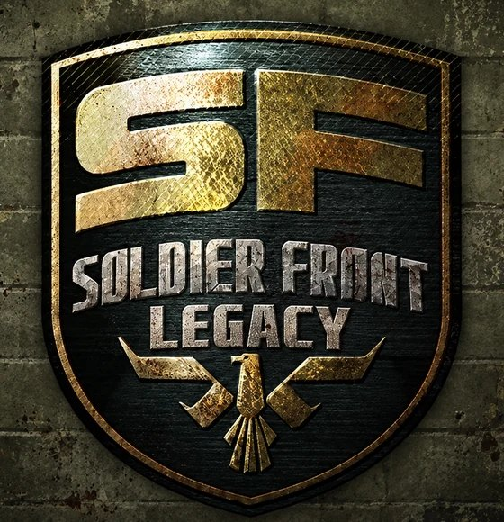
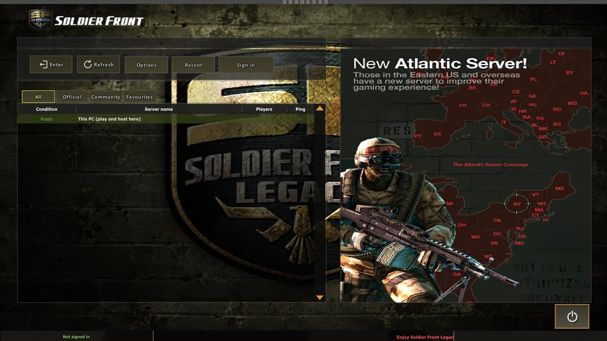
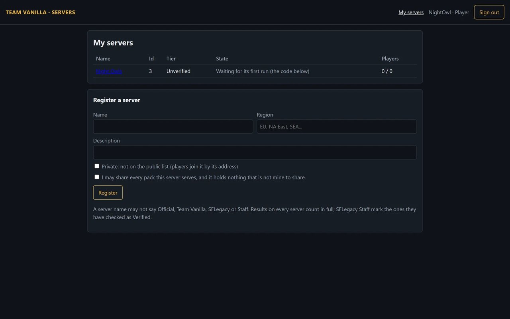
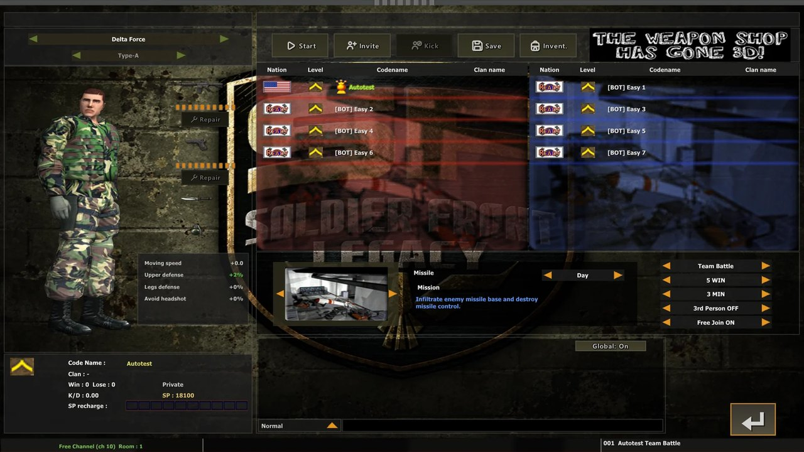
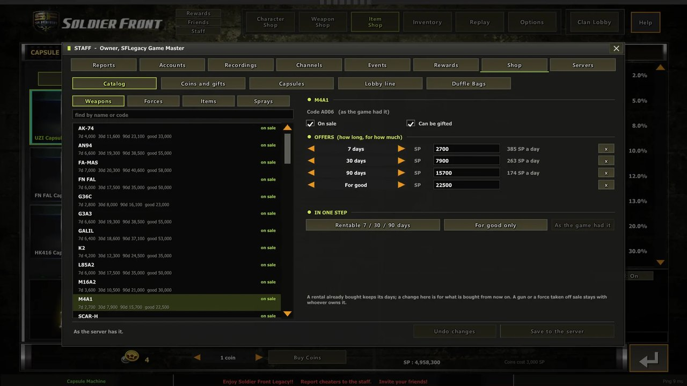
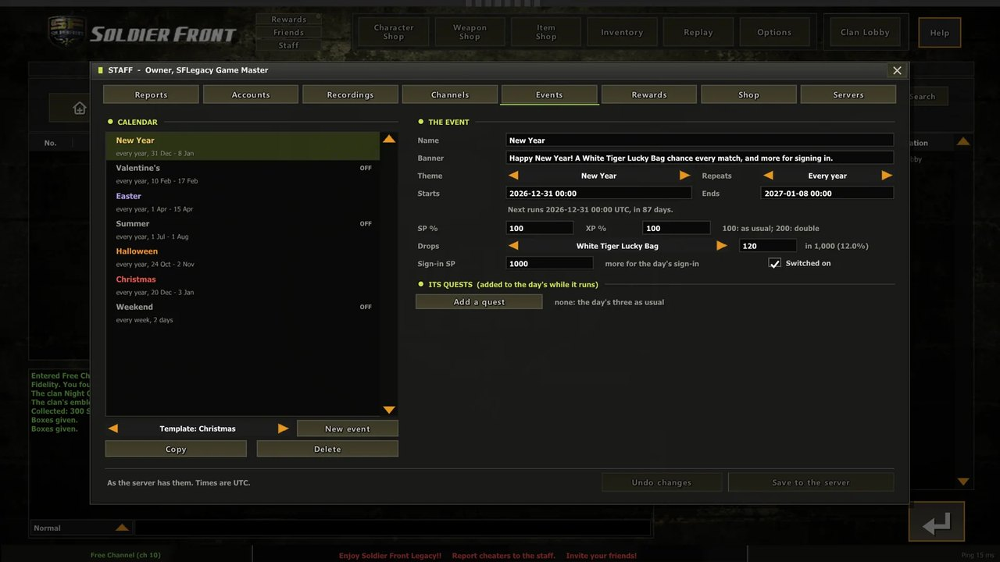
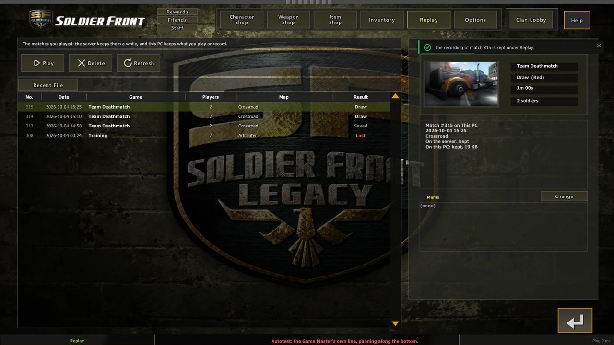
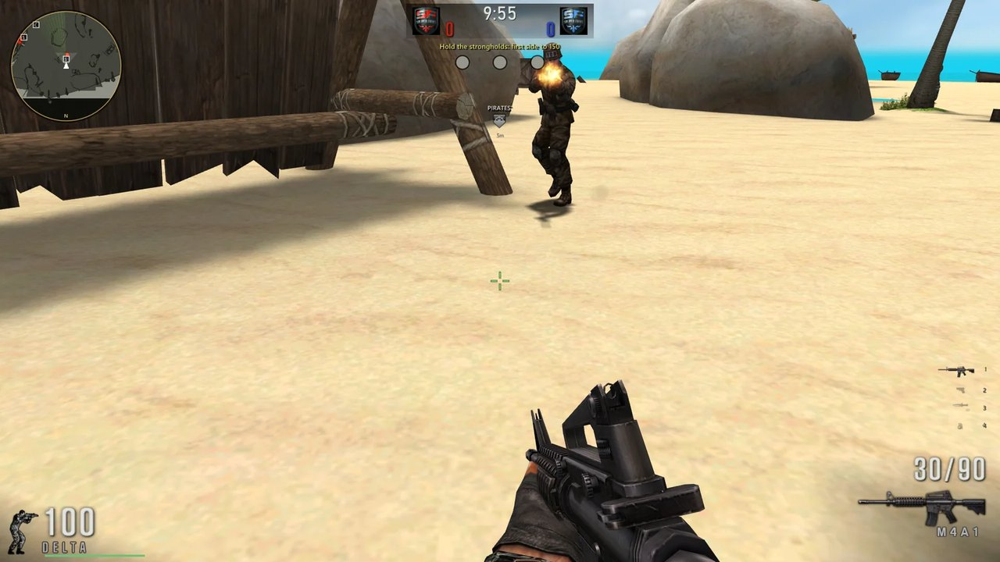
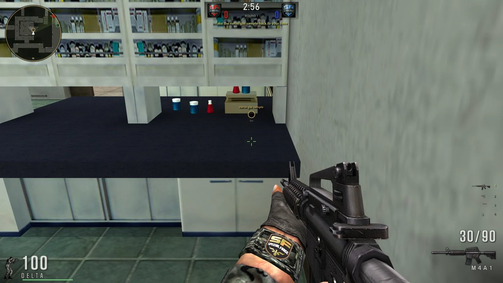
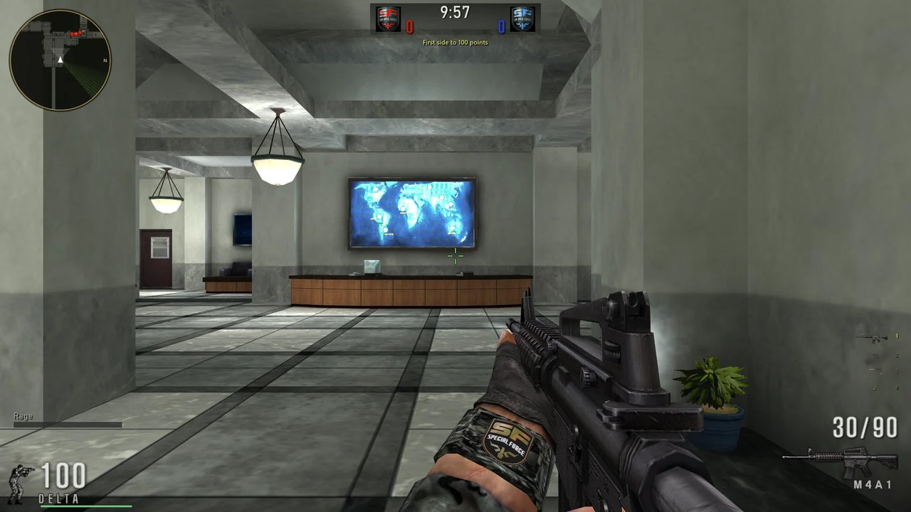

<div align="center">



# Soldier Front Legacy Server

<p><em>The server anyone can run for Soldier Front Legacy: one program for Windows or Linux, every game type with bots, your own staff, channels, shop and packs, and one Team Vanilla account for every player</em></p>

<a href="#">

</a>

<br/>

[](https://en.cppreference.com/w/cpp/23)
[](#-building)
[](#-building)
[](#-the-game)
[](https://teamvanilla.dev)

<br/>

[](../../stargazers)
[](../../issues)
[](../../commits)
[](https://sf.teamvanilla.dev/docs/server/)

<br/>

[](#-features-at-a-glance)
[](#-features-at-a-glance)
[](#-running-a-server)
[](#-features-at-a-glance)
[](#-features-at-a-glance)
[](#-running-a-server)

</div>


**LegacySFServer** is the server for **Soldier Front Legacy**, TeamVanilla's reconstruction of Soldier Front: the same server Team Vanilla runs, for anyone to run on Windows or on Linux (x86-64 and ARM64). Players sign in with their Team Vanilla account, find your server on the list (or join it by address) and play. Their rank, record and SP are Team Vanilla's and follow them everywhere; what your server adds of its own stays on your server.

It plays all 12 game types of the original's waiting room across 40 maps, reading the maps from Soldier Front's own client data (where bots walk, what a soldier can see, what a wall stops), with bots, match recordings, its own staff, channels and shop, and packs of its own that players download as they join. The game is its own repository: [Soldier Front Legacy](https://github.com/tsyvm/soldierfrontlegacy).

The ready-made server for Windows and Linux, and the whole owner's guide, are at **[sf.teamvanilla.dev](https://sf.teamvanilla.dev/docs/server/)**.

<p align="center">



<br/>



<br/>



<br/>
<sub>Taken from the game and Team Vanilla's control panel by their own automated walks, against a test server.</sub>
</p>

<div align="center">

### 📑 Contents

[Features](#-features-at-a-glance) · [Running a Server](#-running-a-server) · [Command Line](#-command-line) · [Requirements](#-requirements)

[Building](#-building) · [The Game](#-the-game) · [Repository Layout](#-repository-layout) · [Known Limitations](#-known-limitations)

[Credits and Ownership](#-credits-and-ownership) · [Links](#-links)

</div>


## ✨ Features at a Glance

**Every game type**
- **All 12**, each by its own rules: Team Battle with its Destroy, Take Back, Escape and Dual missions, Team Deathmatch, Single Battle, Sniper Mode, Capture the Captain, Captain Mode, Horror Mode, Horror Mode 2, Team Slayer, Occupy, Pirate Mode and Training
- **Bots** fill a room and play the objective: they plant and defuse, carry the item home, take the consoles and the strongholds
- **Recordings** of every match, kept 7 days, for players to watch again and staff to judge reports by

**Yours to run**
- **Staff** by Team Vanilla account: Admin, Game Master and Moderator, each with their own powers, and a staff panel in the game (<kbd>F9</kbd>)
- **Channels** and a message of the day; who may join: a rank range, a kill/death ratio, a password
- **A shop of its own**: your packs' items, capsules and their odds, and base items' prices (never below Team Vanilla's)
- **Packs**: your own weapons, maps and characters, built and checked by `lsfpack`, downloaded by players as they join (50 MB in all), and sold in your shop for SP
- **Edited from the game**: the channels and the shop are changed in the staff panel, live, without a restart

**Fair to every player**
- A server never sees a password: players show it a short-lived ticket that Team Vanilla signed
- Base weapons, forces and parts keep their official numbers: an owner can add, nobody can rebalance
- A server cannot add SP or Coins, write anyone's rank or record, or read anyone's whispers and mail
- Team Vanilla checks every match report, and one that could not have happened is refused
- Players report and vote to kick from the match menu; staff see the reports and the recordings


## 🚀 Running a Server

1. **Install it**: build it (below) or download it from **[sf.teamvanilla.dev](https://sf.teamvanilla.dev/download/)**, and put it in a folder of its own. Run it once with `--defaults` to lay out `server.cfg`, `channels.cfg`, `staff.cfg`, `shop.cfg` and its folders, then give the server its `name` in `server.cfg`.
2. **Give it the game data**: copy a Soldier Front installation's `data` folder beside the server, or name that folder as `client_data` in `server.cfg`. The server reads the maps from it.
3. **Make its key**: the first run writes `server.key`, the server's identity, and stops. Keep it safe and to yourself.
4. **Register it**: sign in to Team Vanilla's [control panel](https://api.teamvanilla.dev/ucp) with your game account, choose **Register a server**, and run the server with the code: `LegacySFServer.exe --register CODE`.
5. **Let players in**: forward UDP **27240** (or the port you chose) and allow it through the firewall (`--firewall` on Windows). It is listed once Team Vanilla can reach it.

On Linux, `Server/Distro` holds the systemd unit (`legacysf-server.service`) and the `Containerfile`. Every step in full, with every setting, is in the website's [Running a server](https://sf.teamvanilla.dev/docs/server/) guide.


## 💻 Command Line

| Switch | Does |
|---|---|
| `--register CODE` | Trades the control panel's code for the server's id and writes it into `server.cfg` |
| `--check` | Checks `server.cfg`, the data and the packs, and stops; it talks to nobody |
| `--defaults` | Writes any of `server.cfg`, `channels.cfg`, `staff.cfg` and `shop.cfg` that is missing, and the empty folders |
| `--firewall` | Windows: lets the server through Windows Firewall (Windows asks for an administrator) |
| `--key` | Prints the server's public key, and stops |
| `--dir FOLDER` | The server's folder, when it is not the one the program is in |
| `--config FILE` | A `server.cfg` somewhere else |
| `--help` | Lists the switches |

<kbd>Ctrl</kbd>+<kbd>C</kbd> (or SIGTERM on Linux) saves and stops the server. A crash writes a report to `logs/`.


## 🧰 Requirements

| | |
|---|---|
| **To run** | Windows 64-bit, or Linux on x86-64 or ARM64 with glibc 2.28 or newer (Debian 10, Ubuntu 18.10, RHEL 8 and later), libcurl and the system's certificates |
| **The game data** | A Soldier Front installation's `data` folder: the server reads the maps from it |
| **A port** | UDP players can reach from the internet: shared web hosting usually has none, so a PC, a VPS or a small ARM board |
| **Compiler** | MSVC with C++23 (Visual Studio 2026, generator `Visual Studio 18 2026`) |
| **CMake** | 3.28 or newer |
| **Linux builds** | [Zig](https://ziglang.org/download/) as the cross-compiler, and `py` on the PATH |

Vendored in `vendor/`: stb, and the Soldier Front SDK's file readers.


## 🔨 Building

### Windows

```bat
cmake -S . -B build -G "Visual Studio 18 2026" -A x64
cmake --build build --config Release
```

`bin/LegacySFServer.exe` and `bin/lsfpack.exe` come out, each one file with the C runtime linked in.

### Linux

From Windows, with Zig as the cross-compiler:

```bat
py Tools/build_linux.py --zig <zig folder> --arch both
```

`bin/linux/LegacySFServer` (x86-64) and `bin/linux/arm64/LegacySFServer` (ARM64) come out, with `lsfpack` beside each, for glibc 2.28 and newer. Name the server `legacysf-server` on the machine, as the systemd unit and the container file expect.


## 🎮 The Game

The game, `legacysf.exe`, is its own repository: **[Soldier Front Legacy](https://github.com/tsyvm/soldierfrontlegacy)**. Game and server must speak the same protocol, 25 in this build: a game of another protocol cannot join. `Shared/` is the code both sides are built from (the rules, weapons, movement, game types and the protocol), so they agree on every shot and every step.


## 📁 Repository Layout

```
SoldierFrontLegacy-Server/
├── Server/
│   ├── Source/          ← the server: accounts, rooms, matches, bots, game types, shop, staff, packs, the link to Team Vanilla
│   └── Distro/          ← the owner's README and changelog, the systemd unit, the container file
├── Shared/
│   ├── Engine/          ← core, files, crypto, network, collision
│   ├── SF/              ← Soldier Front's file formats: archives, maps, models
│   └── Game/            ← the rules, weapons, movement, game types and the protocol, shared with the game
├── Tools/               ← lsfpack (builds and checks packs), build_linux.py
├── cmake/               ← source lists
├── vendor/              ← stb, the Soldier Front SDK
├── Docs/img/            ← the pictures on this page
└── CMakeLists.txt
```

Made by the build: `build/`, `bin/`. Made by the server in its own folder: `server.key`, `accounts/`, `packs/`, `recordings/`, `logs/`.


## 🚧 Known Limitations

| Item | Status |
|---|---|
| **Soldier Front's data is not here** | The server reads the maps from an installation's `data` folder, which its owner provides. |
| **A Team Vanilla registration is needed** | A dedicated server never starts without one: its owner's account and the control panel's code. |
| **Shared web hosting will not do** | It has no UDP port a program of yours may open. |
| **Team Vanilla's account service is not here** | Sign-in, rank and the server list are Team Vanilla's service at `api.teamvanilla.dev`. |


## 🙏 Credits and Ownership

**Soldier Front** (*Special Force*) is Dragonfly GF Co., Ltd.'s game: created and developed by Dragonfly in Seoul (2004), published in Korea by Neowiz, opened in North America on ijji by NHN USA (2007) and carried on by Aeria Games (2011). Its maps and data are theirs; none of them is in this repository.

| Soldier Front Legacy | |
|---|---|
| **[TeamVanilla](https://teamvanilla.dev)**, 2026 | The server, the game, Team Vanilla's account service and the website |
| **[stb](https://github.com/nothings/stb)** | Images and compression, public domain or MIT |


## 🔗 Links

| | |
|---|---|
| **[Running a server](https://sf.teamvanilla.dev/docs/server/)** | The owner's guide: installing, registering, the network, Linux and Windows, staff, channels, the shop, packs |
| **[Download](https://sf.teamvanilla.dev/download/)** | The server for Windows and Linux, ready-made |
| **[Control panel](https://api.teamvanilla.dev/ucp)** | Register a server and see your servers |
| **[The server list](https://sf.teamvanilla.dev/servers/)** | Every listed server, live |
| **[TeamVanilla Discord](https://discord.gg/TeJHcV9EJW)** | TeamVanilla: send the server's log with a few words on what happened |

<div align="center">

<sub>Built and maintained by <a href="https://github.com/TsyVM">TsyVM</a> · <a href="https://teamvanilla.dev">TeamVanilla</a></sub>


</div>
